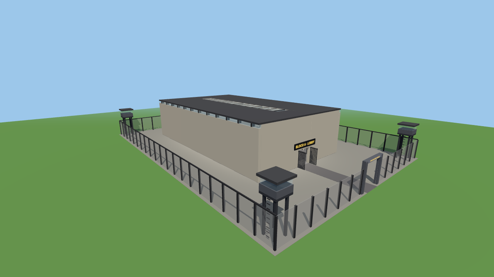
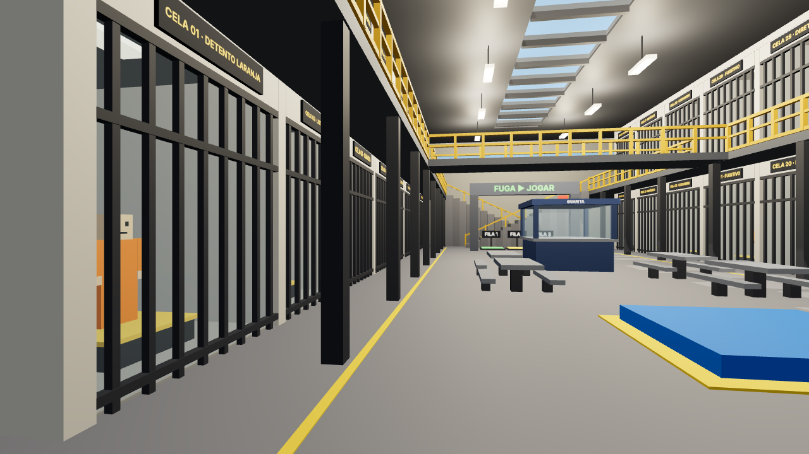
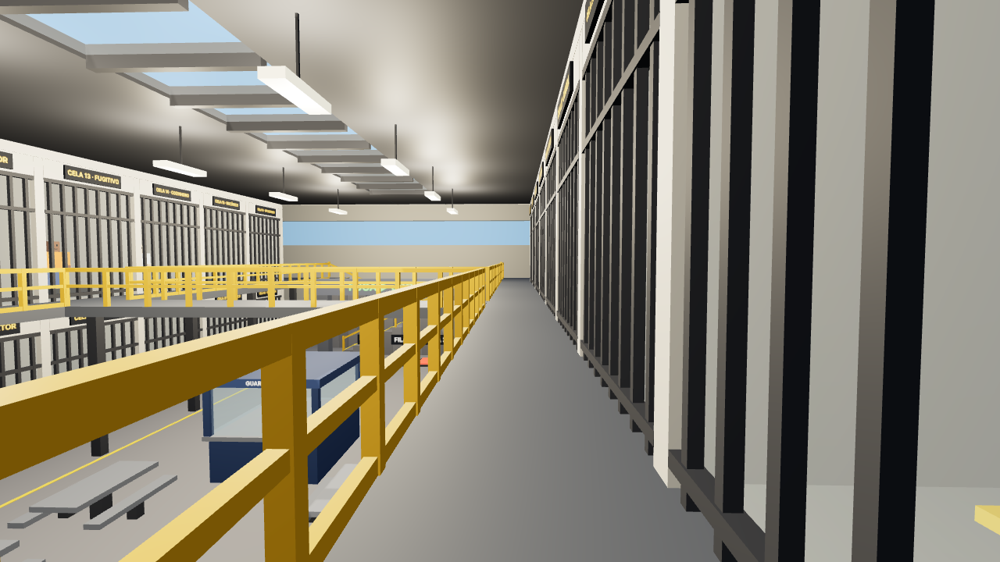

# Lobby Prisão — Roblox

Lobby de prisão feito **só com Part clássico** (shape Block, material SmoothPlastic, superfícies lisas, nenhuma textura ou decal), com **2 andares** e **32 celas showcase em tamanho real** (bonecos R6 de 5 studs em pedestais, atrás de grades e vidro).



| Corredor térreo | 2º andar | Showcase da cela |
|---|---|---|
|  |  |  |

## O que tem no mapa

- **Bloco de celas**: 2 alas (norte/sul) × 2 andares × 8 celas = 32 celas de 12×14×15 studs. Cada uma tem grade, vidro de showcase, pedestal com boneco (8 roupas: Detento Laranja, Listrado Clássico, Guarda, Diretor, Fugitivo, Cozinheiro, Mecânico, VIP Dourado), beliche, vaso, pia, luminária com `PointLight` e placa com o nome (`SurfaceGui`).
- **2º andar**: passarelas com corrimão amarelo, ponte central atravessando o átrio e escadas em tesoura no lado leste.
- **Átrio**: `SpawnLocation`, guarita central, refeitório e a **Zona Jogar** (portal + 3 plataformas de fila).
- **Exterior**: pátio, cerca perimetral com portão, 4 torres de vigia, claraboia no teto.

Total: **1893 Parts**, todas ancoradas.

## Como ver no navegador (Three.js)

- **Prévia do PR**: `https://raw.githack.com/devconnecting1/meu-jogo-do-roblox-lobby/<branch>/index.html`
- **GitHub Pages** (após o merge na `main`, com Pages ativado em *Settings → Pages → Source: GitHub Actions*).
- **Local**: `npm run viewer` e abra http://localhost:8080.

O visualizador tem vistas prontas, liga/desliga teto e paredes e um modo **Andar (WASD)** com física parecida com a do Roblox (WalkSpeed 16, gravidade 196.2, sobe degraus).

## Sincronização com o jogo

| | |
|---|---|
| Universo | `10548333977` |
| Lugar | `116364339053967` |

O mapa inteiro sai de **`src/lobby.js`** (fonte única). O fluxo é:

```
src/lobby.js ──► tools/build-place.mjs ──► build/Lobby.model.json ──► rojo build ──► build/lobby.rbxl ──► Open Cloud
           └──► viewer/main.js (Three.js)
```

- **Automático (CI)**: todo push na `main` que mexe no mapa roda `.github/workflows/roblox-sync.yml`, que compila com Rojo e publica uma versão *Published* no lugar. Em PRs ele só valida o build.
  Requer o segredo **`ROBLOX_API_KEY`** em *Settings → Secrets and variables → Actions* (chave Open Cloud com o escopo `universe-places:write` para esse universo).
- **Manual**:
  ```bash
  rokit install            # instala o Rojo 7.4.4 (ou baixe do GitHub)
  npm run build            # gera build/lobby.rbxl
  ROBLOX_API_KEY=... npm run publish:roblox   # publica (vai ao ar)
  ROBLOX_API_KEY=... npm run publish:saved    # só salva uma versão
  ```
- **Ao vivo no Studio**: `npm run serve` e conecte o plugin do Rojo no Studio.

> ⚠️ A publicação substitui o lugar inteiro. Edições feitas direto no Studio serão sobrescritas na próxima sincronização — altere `src/lobby.js` em vez disso. Versões antigas continuam no histórico de versões do lugar no Creator Hub.

## Zona Jogar

`roblox/LobbyServer.server.lua` escuta as plataformas **Fila 1/2/3**. Defina `TARGET_PLACE_ID` com o ID do lugar do jogo principal para teletransportar os jogadores (com `0` ele só registra no output).
