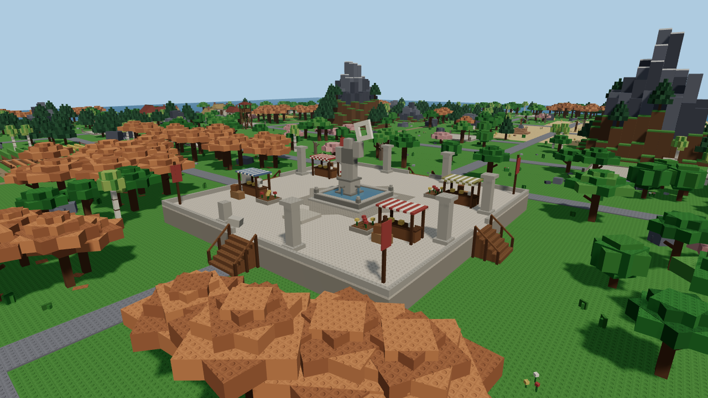
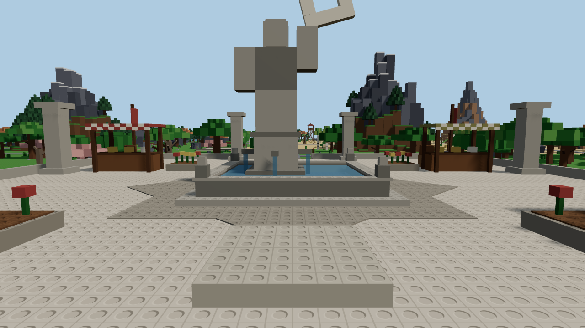
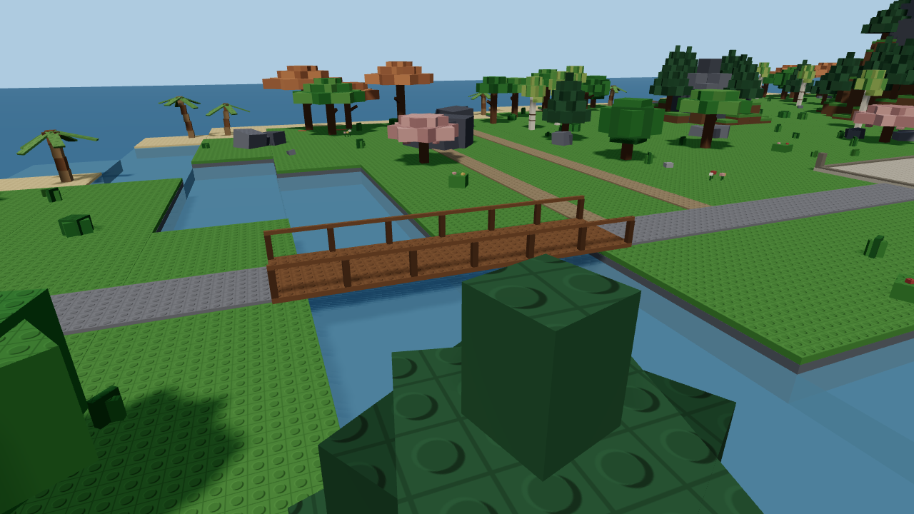

# Reino — Roblox

Mapa base de um jogo de estratégia no estilo **Lords Mobile**, feito só com **Part clássico** (studs em cima, inlet embaixo) e cores neutras. Ainda não tem UI, NPC, script nem castelos de jogador: é o terreno onde os castelos vão ficar. O GitHub Actions testa, compila, renderiza e publica tudo automaticamente.


| | |
|---|---|
|  |  |
|  |  |

*As imagens são geradas pelo CI a cada push na `main`. Em PRs, elas aparecem no comentário "📸 Como ficou".*

## O que tem

- **Ilha de 1200×1200 studs** cercada de mar, com praia, lago e um rio que corta o oeste até o mar.
- **30 lotes de castelo** (20 para jogadores e 10 para bots), espalhados pelo mapa com folga entre eles. Cada lote tem fundação de 32×32 com studs, meio-fio, marcos nos cantos e bandeira. O jogo vai sortear depois quem fica em cada lote.
- **Lobby** no centro, como nas referências: plataforma elevada de studs com mureta e 4 escadarias de madeira com corrimão, fonte octogonal com a estátua do boneco clássico erguendo o logo, 4 lojas de verdade (padaria, taverna, ferreiro e armazém) viradas para os caminhos, arcos de pedra no alto das escadarias, lampiões, bancos, vasos com árvore, caixotes, colunas antigas (algumas partidas) e o spawn sobre um mosaico em estrela.
- **Estradas de pedra** ligando todos os lotes ao Lobby e **pontes de madeira** com guarda-corpo sobre o rio.
- **Natureza:** florestas verdes e bosques de outono com árvores de copa em camadas, arbustos, pedras e **planaltos de rocha** com topo de grama e escadaria de pedra para subir.
- **Recursos** (futuros pontos de coleta): campos de trigo cercados, jazidas de ouro e pedreiras.
- **Costa:** cais de madeira com barco amarrado.
- **Estilo clássico do Roblox:** Plastic com studs em cima e inlet embaixo em todas as peças (o mar e a água ficam lisos).
- **Luz realista** (Lighting Future, começo da tarde, sol forte com sombra nítida, reflexo do céu nas texturas, neblina leve no horizonte).
- **Vegetação densa:** até 1300 árvores, ~1800 tufos de mato, arbustos, flores, juncos na beira da água e samambaias nas florestas.
- **Manual de montagem:** o CI gera etapas de até 8 peças e verifica que cada uma se apoia no que já foi montado.
- **Peças do Lobby:** fonte octogonal de dois andares com 8 filetes de água e borda para sentar; lojas de verdade (padaria, ferreiro, armazém e taverna) com vitrine aberta, balcão, placa pendurada e toldo listrado; banco de praça, vaso com árvore, arco de pedra e lampião (`src/props/lobby.js`).
- **Catálogo de peças:** cada peça reaproveitável (estátua, árvores, arbusto, flores, construções e peças do Lobby) sozinha no seu chão de studs, fotografada pelo CI normal e com a colisão destacada em vermelho ([`viewer/catalog.html`](viewer/catalog.html), tabela em `CATALOG.md` no branch `ci-previews`).
- **Fuzz de 100 mil mapas:** um workflow separado (*Actions → Fuzz de mapas → Run workflow*, e toda segunda-feira) testa as regras de layout em 100 mil sementes e a construção completa numa amostra; todo PR testa 26 sementes. Veja [docs/FUZZ.md](docs/FUZZ.md).

A prisão do projeto anterior está guardada no branch [`arquivo/prisao`](https://github.com/devconnecting1/Meu-jogo-do-Roblox-Lobby/tree/arquivo/prisao).

## Como funciona

```
src/map.js ─┬─► src/rojo.js ─► Rojo ─► reino.rbxl ─► Open Cloud ─► Roblox
            ├─► viewer/main.js (Three.js) ─► capturas do CI / GitHub Pages
            └─► tests/ (apoio, z-fighting, passagens, lotes, estradas, estilo)
```

Tudo roda em `.github/workflows/ci.yml` (`ubuntu-latest`). Os jobs são **lint (ESLint + Prettier) → test → build → render → publish** (e **pages** na `main`). Veja as regras completas em [AGENTS.md](AGENTS.md).

### Publicação no Roblox

| | |
|---|---|
| Universo | `10548333977` |
| Lugar | `116364339053967` |

Configure em *Settings → Secrets and variables → Actions*:

- `ROBLOX_CLOUD_API`: chave Open Cloud com o escopo `universe-places:write`. **Use a aba Secrets.** O CI também aceita Variables e mascara a chave nos logs.
- `ROBLOX_UNIVERSE_ID` e `ROBLOX_LOCAL_ID`: opcionais.

A publicação acontece em PRs do próprio repositório, em todo push na `main` e manualmente (*Actions → CI → Run workflow*), sempre depois dos testes e do build passarem.

> A publicação substitui o lugar inteiro, então não edite o mapa no Studio. As versões anteriores ficam no histórico do Creator Hub.

### Visualizador 3D

- Prévia de qualquer branch: `https://raw.githack.com/devconnecting1/Meu-jogo-do-Roblox-Lobby/<branch>/index.html`
- GitHub Pages (depois do merge na `main`): ative em *Settings → Pages → Source: GitHub Actions*.
