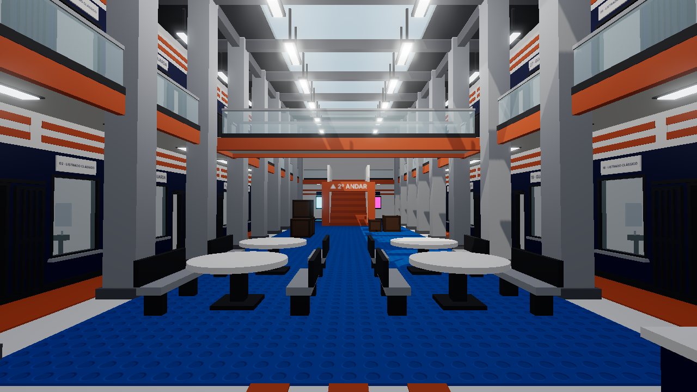
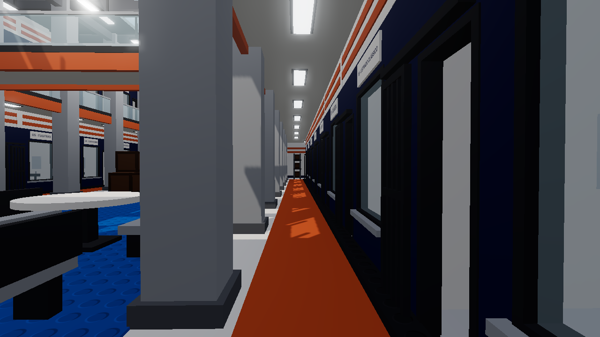
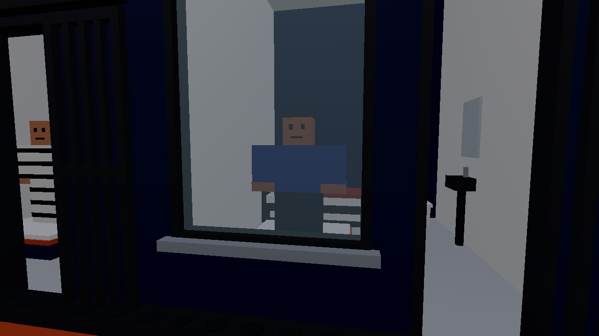
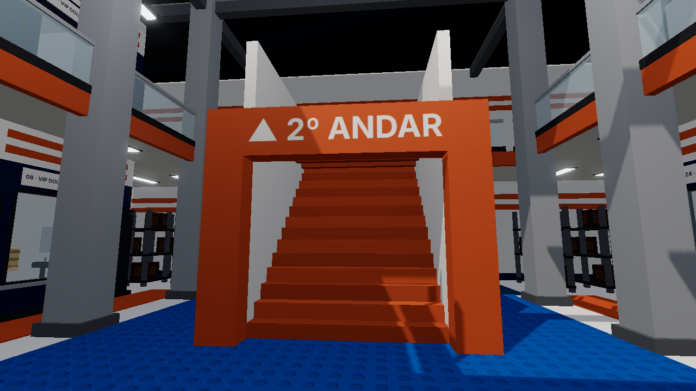
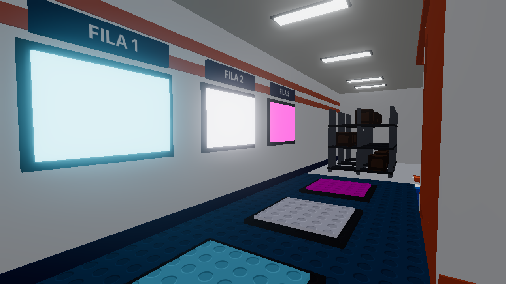
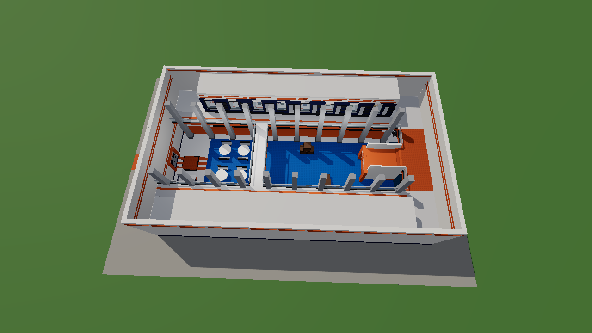

# Lobby Prisão — Roblox

Lobby de prisão no **estilo clássico** do Roblox. Usa só Part clássico (Block, e Cylinder nas mesas redondas), material Plastic, Neon nas lâmpadas e telas, e studs clássicos nos pisos. Não tem nenhuma textura, decal ou MeshPart. São **2 andares** e **32 celas showcase em tamanho real**, cada uma com um boneco R6 de 5 studs num pedestal, visto pela janela da cela.



| Corredor das celas | 2º andar | Cela showcase |
|---|---|---|
|  |  |  |
| **Escada** | **Zona Jogar** | **Planta** |
|  |  |  |

## Direção de arte (o que copiamos do builder de referência)

| Princípio | Como aparece no mapa |
|---|---|
| **Paleta de 3 cores** | Branco nas paredes, laranja queimado nos destaques e azul-marinho nas fachadas das celas. O azul royal só aparece no piso do átrio. |
| **Listras como assinatura** | Faixas laranja duplas acima de cada cela, nas paredes de topo e na fachada externa. |
| **Studs só no chão** | Piso do átrio, patamar da escada, meio-fios, rodapés do vidro e plataformas. As paredes são lisas, para não poluir a vista. |
| **Ritmo estrutural** | Colunas cinza de 2,6 studs a cada 13 studs, alinhadas às divisórias das celas, e vigas no teto na mesma cadência. |
| **Luz que vira objeto** | Luminárias fluorescentes (carcaça escura com 2 tubos Neon) penduradas no átrio e no 2º andar, e painéis embutidos sob a passarela. |
| **Transparência no 2º andar** | Guarda-corpo de vidro com rodapé escuro e corrimão cinza, para enxergar as celas do outro lado. |
| **Celas legíveis** | Fachada marinho com janela de showcase e porta de grade deslizante aberta. Por dentro tem parede branca, fundo marinho, cama com cobertor vermelho, vaso, pia com espelho e luz no teto. |
| **Escala de jogador** | Pé-direito de 15 por andar, corredores de 5 a 8 studs, degraus de 1 stud e porta de 3×9. |

## O que tem no mapa

- **Átrio de pé-direito duplo** com refeitório (mesas redondas e bancos com encosto), caixas de madeira e ponte de vidro no 2º andar.
- **32 celas** em 2 alas × 2 andares × 8. A roupa do boneco muda por cela: Detento Laranja, Listrado Clássico, Guarda, Diretor, Fugitivo, Cozinheiro, Mecânico e VIP Dourado.
- **Escada laranja com pórtico** levando ao mezanino.
- **Hall de entrada** com `SpawnLocation`, recepção e portão.
- **Depósitos**: os do oeste são fechados e têm janela. Sob o mezanino há estantes abertas.
- **Zona Jogar**: 3 telas Neon (ciano, branco e magenta) com as plataformas *Fila 1/2/3*.

São **2942 Parts** ancoradas e 80 `PointLight`.

## Próximas recomendações

1. **Iluminação `Future`** em *Lighting → Technology*. O Neon passa a "acender" o ambiente como na referência. Esse valor não pode ser definido por script nem pelo Rojo, então precisa ser mudado uma vez no Studio.
2. **Teleporte**: preencha `TARGET_PLACE_ID` em `roblox/LobbyServer.server.lua`.
3. **StreamingEnabled** ligado, para celulares fracos. O mapa já é todo ancorado e não tem física.
4. **Áudio ambiente** (zumbido de lâmpada e portões) com `Sound` em `SoundService`.

## Como ver no navegador (Three.js)

- **Prévia do PR**: `https://raw.githack.com/devconnecting1/Meu-jogo-do-Roblox-Lobby/<branch>/index.html`
- **GitHub Pages**: depois do merge na `main`, com o Pages ativado em *Settings → Pages → Source: GitHub Actions*.
- **Local**: `npm run viewer` e abra http://localhost:8080.

O visualizador tem 8 vistas prontas, liga e desliga teto e paredes, mostra brilho (bloom) no Neon e tem um modo **Andar (WASD)** com física parecida com a do Roblox (WalkSpeed 16, gravidade 196,2, sobe degraus). Os studs no navegador são só uma simulação visual da superfície *Studs*.

## Sincronização com o jogo

| | |
|---|---|
| Universo | `10548333977` |
| Lugar | `116364339053967` |

```
src/lobby.js ──► tools/build-place.mjs ──► build/Lobby.model.json ──► rojo build ──► build/lobby.rbxl ──► Open Cloud
           └──► viewer/main.js (Three.js)
```

- **Automático (CI)**: todo push na `main` que altera o mapa roda `.github/workflows/roblox-sync.yml`. Esse workflow compila com o Rojo e publica no lugar. Em PRs ele só valida o build.
  Requer o segredo **`ROBLOX_API_KEY`** em *Settings → Secrets and variables → Actions*, com uma chave Open Cloud que tenha o escopo `universe-places:write` para esse universo.
- **Manual**:
  ```bash
  rokit install                               # instala o Rojo 7.4.4
  npm run build                               # gera build/lobby.rbxl
  ROBLOX_API_KEY=... npm run publish:roblox   # publica (vai ao ar)
  ROBLOX_API_KEY=... npm run publish:saved    # só salva uma versão
  ```
- **Ao vivo no Studio**: rode `npm run serve` e conecte o plugin do Rojo.

> ⚠️ A publicação substitui o lugar inteiro. Edições feitas direto no Studio são sobrescritas na próxima sincronização, então altere o `src/lobby.js`. As versões antigas continuam no histórico de versões do Creator Hub.
