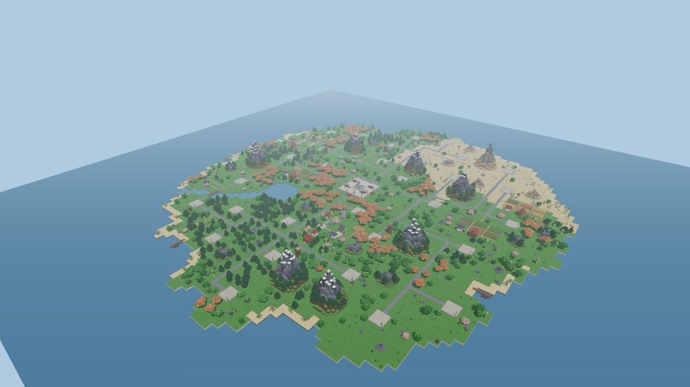
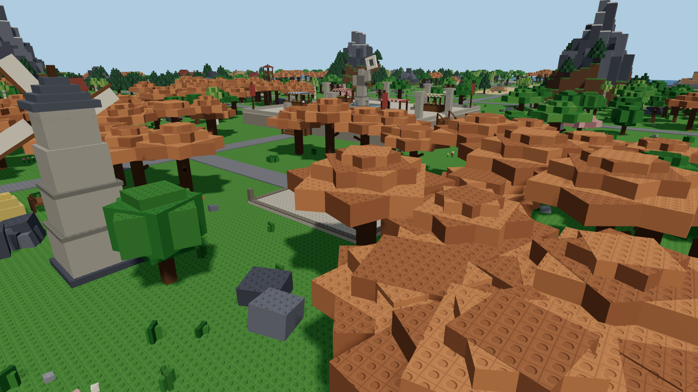

# Reino — Roblox

Mapa base de um jogo de estratégia no estilo **Lords Mobile** no Roblox. **Fase atual: o Vale com as construções**: terreno em estilo voxel pixelado (blocos lisos, bordas em escada, cores quentes), com os 8 prédios do Lobby e os 30 castelos mobiliados por dentro. O GitHub Actions testa, compila, renderiza e publica tudo automaticamente.



| | |
|---|---|
|  |  |
|  |  |

*As imagens são geradas pelo CI a cada push na `main`. Em PRs, elas aparecem no comentário "📸 Como ficou".*

## O que tem

- **Mapa fixo:** um planalto com o vale no meio, sempre igual em todo servidor (sem geração procedural nem sorteio de mapa).
- **Lobby** no centro: praça de pedra clara com faixas escuras pixeladas, estrado no meio com a **estátua de Luvitlua** (o boneco R6 oficial do Roblox, sem roupa nem itens, sobre pedestal com o nome em letras de pixel) e o spawn.
- **Áreas com a planta do prédio:** 8 áreas em volta da praça, cada uma com o formato da construção que vai receber (taverna em L, capela em cruz, torre redonda, estábulo em U, mercado com alpendre…), e **30 lotes de castelo** (20 jogadores e 10 bots) com 7 plantas diferentes (fortaleza com torres, castelo em L, redondo, com pátio, em cruz, em U e em T), todos planos, com borda de pedra e a frente virada para o Lobby.
- **Estradas de terra** com borda serrilhada ligando a praça a todas as áreas e lotes; passagem de pedra sobre as lagoas.
- **Relevo:** penhascos de rocha em blocos com musgo no topo cercando boa parte do vale, borda aberta sobre o mar no resto, terraços de grama e lagoas.
- **Estilo voxel liso:** SmoothPlastic sem studs, grama com manchas escuras em blocos, paleta quente (`src/palette.js`, grupo `px…`).
- **Luz de fim de tarde** (Lighting Future, sombra nítida, neblina leve no horizonte).
- **Manual de montagem:** o CI gera etapas de até 8 peças e verifica que cada uma se apoia no que já foi montado.
- **Prédios do Lobby com interior** (`src/props/lojas.js`): Taverna (balcão, barris, mesas, lareira), Ferraria (forja acesa, bigorna, tina, armas), Mercado Coberto (barracas com toldo e mercadorias), Capela (bancos, altar, castiçais), Torre do Mago (estantes, bola de cristal, caldeirão, luneta), Estábulo (baias com feno e cocho, selas), Banco (escadaria com colunas, caixas com grade, cofre, ouro) e Salão do Clã (mesa redonda, quadro de missões, troféu). Cada um com piso, paredes de base de pedra, janelas acesas, porta de 6 studs, telhado em degraus e uma luz.
- **Castelos com interior** (`src/props/castelos.js`): muralha com ameias e portão (a Fortaleza com 4 torres redondas), pátio de pedra com poço, boneco de treino, barris e caixotes, e a torre de menagem com trono, tapete, estandartes, baú, lareira e lanças. Telhado e bandeiras na cor do dono (ardósia e azul para jogadores, telha e vermelho para bots).
- **Base comum** (`src/props/oficina.js`, `src/props/moveis.js`): planta rasterizada em 1 stud, paredes em camadas, porta, janelas e telhado automáticos, e móveis que só entram se couberem no piso livre e fora da passagem.

**Guardados:** o Reino clássico até a versão 21 (ilha com vilas, fazendas, biomas, montanhas, Lobby com lojas e fonte, catálogo de peças, Plastic com studs) está no branch [`arquivo/reino-classico`](https://github.com/devconnecting1/Meu-jogo-do-Roblox-Lobby/tree/arquivo/reino-classico), e a prisão do projeto anterior no [`arquivo/prisao`](https://github.com/devconnecting1/Meu-jogo-do-Roblox-Lobby/tree/arquivo/prisao).

## Como funciona

```
src/map.js ─┬─► src/rojo.js ─► Rojo ─► reino.rbxl ─► Open Cloud ─► Roblox
            ├─► viewer/main.js (Three.js) ─► capturas do CI / GitHub Pages
            └─► tests/ (apoio, z-fighting, passagens, lotes, estradas, relevo, estilo)
```

Tudo roda em `.github/workflows/ci.yml` (`ubuntu-latest`). Os jobs são **lint (ESLint + Prettier) → test → build → render → publish** (e **pages** na `main`). Veja as regras completas em [AGENTS.md](AGENTS.md).

### Publicação no Roblox

| | |
|---|---|
| Universo | `10548333977` |
| Lugar | `116364339053967` |

Configure em *Settings → Secrets and variables → Actions*:

- `ROBLOX_CLOUD_API`: chave Open Cloud com o escopo `universe-places:write`. **Use a aba Secrets.** O CI também aceita Variables e mascara a chave nos logs.
- `ROBLOX_UNIVERSE_ID` e `ROBLOX_LOCAL_ID`: opcionais.

A publicação acontece em PRs do próprio repositório, em todo push na `main` e manualmente (*Actions → CI → Run workflow*), sempre depois dos testes e do build passarem.

> A publicação substitui o lugar inteiro, então não edite o mapa no Studio. As versões anteriores ficam no histórico do Creator Hub.

### Visualizador 3D

- Prévia de qualquer branch: `https://raw.githack.com/devconnecting1/Meu-jogo-do-Roblox-Lobby/<branch>/index.html`
- GitHub Pages (depois do merge na `main`): ative em *Settings → Pages → Source: GitHub Actions*.
