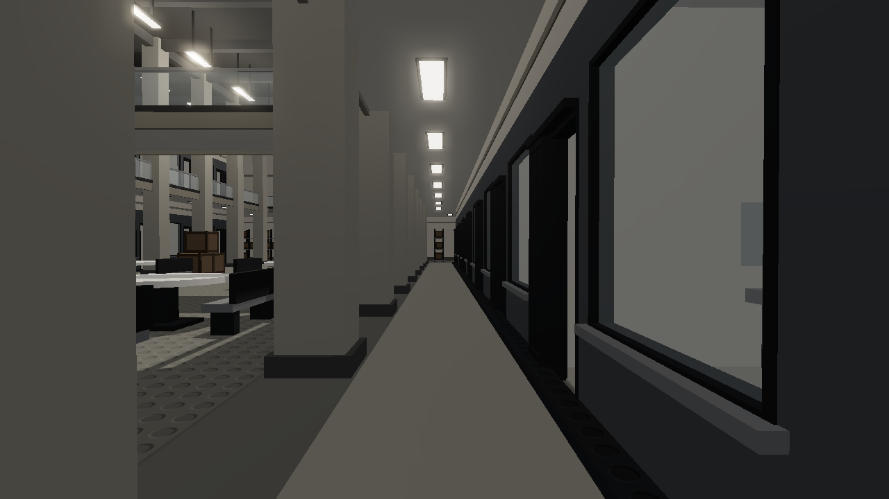
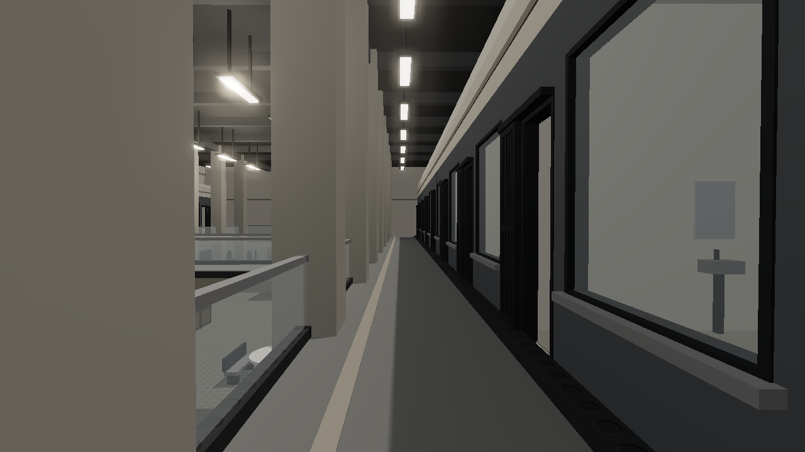
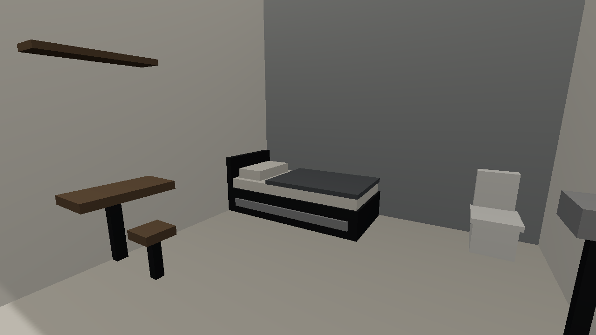

# Prisão — Roblox

Prisão **fechada e espaçosa** de 2 andares, feita só com **Part clássico** em cores neutras. Não tem UI, NPC nem script: é apenas a construção. O GitHub Actions testa, compila, renderiza e publica tudo automaticamente.


| | |
|---|---|
|  |  |
|  |  |

*As imagens são geradas pelo CI a cada push na `main`. Em PRs, elas aparecem no comentário "📸 Como ficou".*

## O que tem

- **Envoltória fechada:** piso, teto e 4 paredes opacos. Não há janelas para fora nem exterior. O único vão é o portal do **túnel de acesso**, que também é fechado.
- **Túnel de acesso:** do fim do corredor de serviço, uma eclusa com **portão de emergência bipartido aberto** (duas folhas que se encontram no meio), um túnel de 40 studs com costelas de aço, e no fundo o **mesmo portão, fechado** (reservado para uma atualização futura).
- **32 celas** em 2 alas × 2 andares. Cada uma tem fachada com janela de observação, porta de grade deslizante, cama, vaso, pia com espelho, mesa, banqueta, prateleira e luz embutida.
- **Bloco de celas** com átrio de pé-direito duplo, piso em xadrez clássico com studs, colunas com base e capitel, e luminárias de galpão presas ao teto.
- **Salas próprias:** hall com spawn e posto de guarda, sala dos guardas, rouparia, sala de visitas e estoque de uniformes sob o mezanino; no 2º andar, sala de controle, diretoria, arquivo, descanso, vestiário, biblioteca e sala de aula; na ala oeste, refeitório, almoxarifado e enfermaria.
- **Acabamento clássico:** relevo das superfícies do Roblox (Inlet, Weld, Universal) em rodapés, colunas, pisos de corredor, túnel e portões, sempre em Parts.
- **Escala ampla** (como na referência): celas de 14×16, corredores de 10, vão central de 48 e 27 studs do 2º andar ao teto.
- **Manual de montagem:** o CI gera etapas de até 8 peças e verifica que cada uma se apoia no que já foi montado. O resumo é "N peças · N etapas · N pontos de conexão verificados", com imagens da montagem em estágios.
- **Luz equilibrada:** tecnologia Future, sem sol, ambiente e exposição baixos, bloom leve e todas as luminárias no mesmo patamar de brilho (testado), para nenhuma sala estourar com gráficos baixos.

## Como funciona

```
src/prison.js ─┬─► src/rojo.js ─► Rojo ─► prisao.rbxl ─► Open Cloud ─► Roblox
               ├─► viewer/main.js (Three.js) ─► capturas do CI / GitHub Pages
               └─► tests/ (apoio, z-fighting, passagens, guarda-corpo, estilo)
```

Tudo roda em `.github/workflows/ci.yml` (`ubuntu-latest`). Os jobs são **lint (ESLint + Prettier) → test → build → render → publish** (e **pages** na `main`). Veja as regras completas em [AGENTS.md](AGENTS.md).

### Publicação no Roblox

| | |
|---|---|
| Universo | `10548333977` |
| Lugar | `116364339053967` |

Configure em *Settings → Secrets and variables → Actions*:

- `ROBLOX_CLOUD_API`: chave Open Cloud com o escopo `universe-places:write`. **Use a aba Secrets.** O CI também aceita Variables e mascara a chave nos logs.
- `ROBLOX_UNIVERSE_ID` e `ROBLOX_LOCAL_ID`: opcionais.

A publicação acontece em PRs do próprio repositório, em todo push na `main` e manualmente (*Actions → CI → Run workflow*). Ela sempre roda depois dos testes e do build passarem.

> A publicação substitui o lugar inteiro, então não edite a prisão no Studio. As versões anteriores ficam no histórico do Creator Hub.

### Visualizador 3D

- Prévia de qualquer branch: `https://raw.githack.com/devconnecting1/Meu-jogo-do-Roblox-Lobby/<branch>/index.html`
- GitHub Pages (depois do merge na `main`): ative em *Settings → Pages → Source: GitHub Actions*.

Tem 10 vistas, corte sem teto e modo **Andar (WASD)** com física parecida com a do Roblox.
