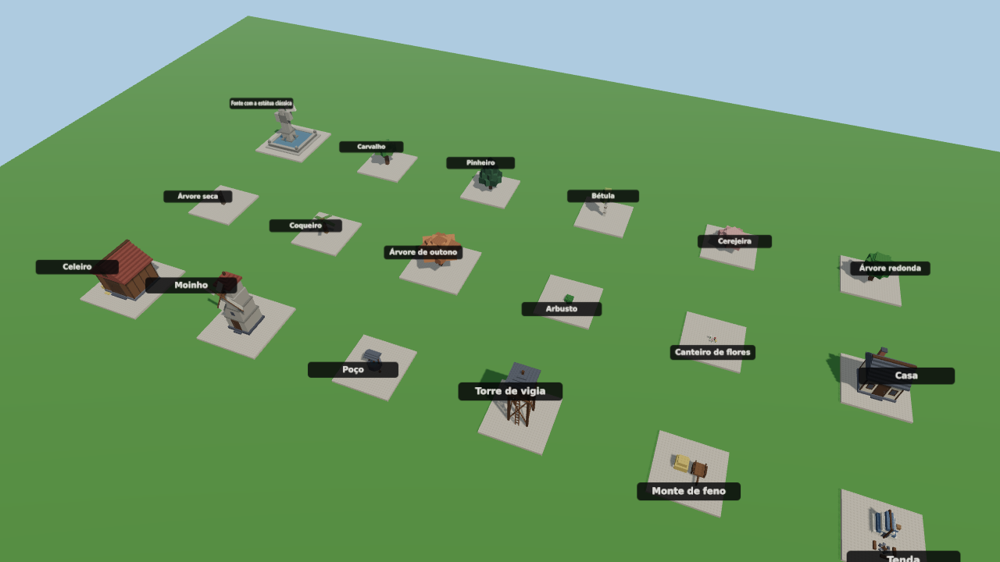

# Catálogo de peças

Gerado pelo CI (`tools/catalog-shots.mjs`) a partir de `src/catalog.js`: cada peça reaproveitável sozinha no seu chão de studs. Na imagem "colisão", o que colide fica vermelho e o resto translúcido.

**18 peças** · 303 partes (fora os chãos) · 200 com colisão

[Todas as peças com colisão](catalogo-todos-colisao.png)

| Grupo | Peça | Partes | Partes com colisão | Tamanho (L × A × P) | O que colide | Imagens |
|---|---|---:|---:|---|---|---|
| Estátua | Fonte com a estátua clássica | 41 | 32 | 22 × 26,8 × 22 | Base do Pedestal, Bica, Borda, Braço Esquerdo, Braço Levantado, Cabeça da Estátua, Corpo do Pedestal, Degrau da Fonte, Fundo da Fonte, Mureta, Perna Direita, Perna Esquerda, Pilar do Canto, Remate do Pilar, Tampo do Pedestal, Topo da Cabeça, Tronco da Estátua | [normal](catalogo-fonte.png) · [colisão](catalogo-fonte-colisao.png) |
| Árvores | Carvalho | 6 | 1 | 11,6 × 13,2 × 11,6 | Tronco | [normal](catalogo-arvore-carvalho.png) · [colisão](catalogo-arvore-carvalho-colisao.png) |
| Árvores | Pinheiro | 10 | 1 | 12,1 × 18,6 × 12,1 | Tronco | [normal](catalogo-arvore-pinheiro.png) · [colisão](catalogo-arvore-pinheiro-colisao.png) |
| Árvores | Bétula | 8 | 1 | 6,3 × 15,9 × 6,3 | Tronco | [normal](catalogo-arvore-betula.png) · [colisão](catalogo-arvore-betula-colisao.png) |
| Árvores | Cerejeira | 8 | 1 | 13,6 × 7,9 × 13,6 | Tronco | [normal](catalogo-arvore-cerejeira.png) · [colisão](catalogo-arvore-cerejeira-colisao.png) |
| Árvores | Árvore redonda | 5 | 1 | 12,3 × 12,9 × 12,3 | Tronco | [normal](catalogo-arvore-redonda.png) · [colisão](catalogo-arvore-redonda-colisao.png) |
| Árvores | Árvore seca | 3 | 1 | 4,9 × 8,3 × 5 | Tronco | [normal](catalogo-arvore-seca.png) · [colisão](catalogo-arvore-seca-colisao.png) |
| Árvores | Coqueiro | 12 | 1 | 12 × 8,9 × 11,3 | Tronco | [normal](catalogo-arvore-coqueiro.png) · [colisão](catalogo-arvore-coqueiro-colisao.png) |
| Árvores | Árvore de outono | 9 | 1 | 19,3 × 14,8 × 19,3 | Tronco | [normal](catalogo-arvore-outono.png) · [colisão](catalogo-arvore-outono-colisao.png) |
| Árvores | Arbusto | 3 | 0 | 3,6 × 2,1 × 4,4 | — | [normal](catalogo-arbusto.png) · [colisão](catalogo-arbusto-colisao.png) |
| Árvores | Canteiro de flores | 8 | 0 | 3,1 × 1,8 × 2,4 | — | [normal](catalogo-canteiro.png) · [colisão](catalogo-canteiro-colisao.png) |
| Construções | Casa | 35 | 34 | 14,4 × 17,5 × 12,9 | Base de Pedra, Batente, Caixilho, Chaminé, Cumeeira, Degrau, Parede, Porta, Poste de Canto, Telhado, Topo da Chaminé, Verga, Vidraça, Viga | [normal](catalogo-construcao-casa.png) · [colisão](catalogo-construcao-casa-colisao.png) |
| Construções | Celeiro | 40 | 37 | 20,2 × 19,6 × 17 | Base do Celeiro, Batente, Cumeeira, Fardo de Feno, Folha da Porta, Parede do Celeiro, Portinhola do Palheiro, Poste de Canto, Ripa, Soleira, Telhado, Travessa, Verga | [normal](catalogo-construcao-celeiro.png) · [colisão](catalogo-construcao-celeiro-colisao.png) |
| Construções | Moinho | 28 | 20 | 18,9 × 31,1 × 11,4 | Base do Moinho, Batente, Cinta de Pedra, Cubo, Degrau, Eixo, Janela, Ponta, Porta, Telhado do Moinho, Torre do Moinho, Verga | [normal](catalogo-construcao-moinho.png) · [colisão](catalogo-construcao-moinho-colisao.png) |
| Construções | Poço | 19 | 16 | 6,4 × 8 × 5,2 | Balde, Borda do Poço, Fundo do Poço, Poste do Poço, Sarilho, Telhado do Poço | [normal](catalogo-construcao-poco.png) · [colisão](catalogo-construcao-poco-colisao.png) |
| Construções | Torre de vigia | 34 | 26 | 9,6 × 26,9 × 9,6 | Banzo da Escada, Degrau da Escada, Parapeito, Perna, Plataforma, Ponta, Telhado da Torre | [normal](catalogo-construcao-torre.png) · [colisão](catalogo-construcao-torre-colisao.png) |
| Construções | Monte de feno | 10 | 8 | 10,3 × 3,9 × 7,8 | Apoio, Caçamba, Eixo, Monte de Feno, Tábua Lateral, Varal | [normal](catalogo-construcao-feno.png) · [colisão](catalogo-construcao-feno-colisao.png) |
| Construções | Tenda | 24 | 19 | 8,3 × 6,5 × 13,8 | Caixote, Cinzas, Cumeeira, Entrada, Lona, Mastro, Pedra da Fogueira, Tronco de Sentar | [normal](catalogo-construcao-tenda.png) · [colisão](catalogo-construcao-tenda-colisao.png) |
